# LiftBros 🏋️

An iOS app for gym-goers to log lifts, climb their gym's leaderboard and break into the UK's national top 100. It launches across **every gym in Worcestershire** (70 gyms; see [docs/GYMS.md](docs/GYMS.md)).

## Screenshots

| Train | Workout | Log a set | Set proof |
|---|---|---|---|
| 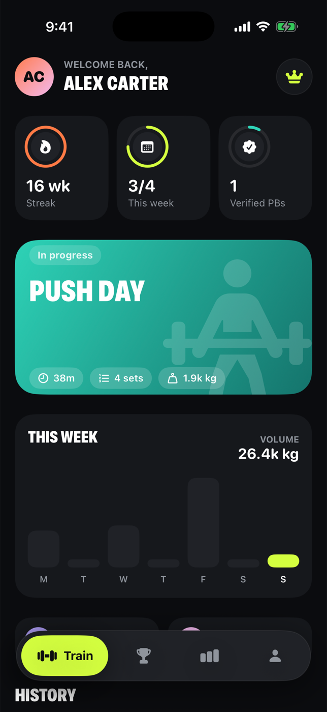 | 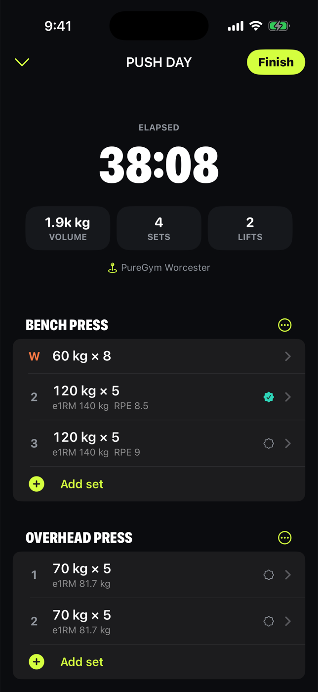 | 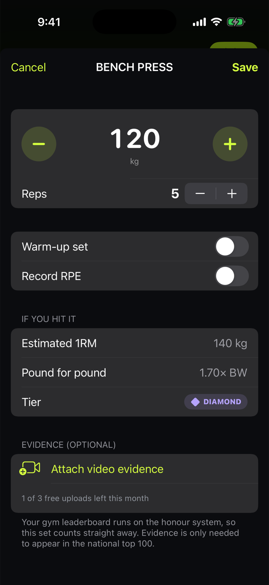 | 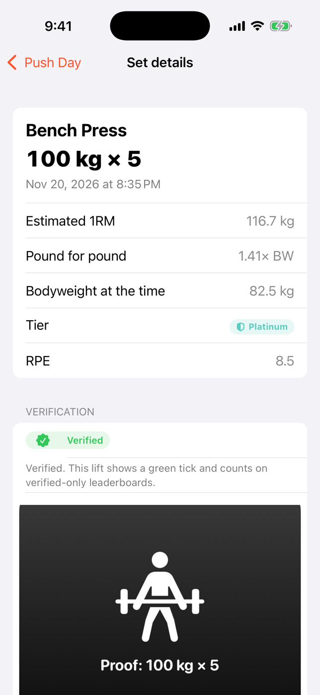 |

| Gym rankings | UK rankings | Pound for pound | Other lifter |
|---|---|---|---|
| 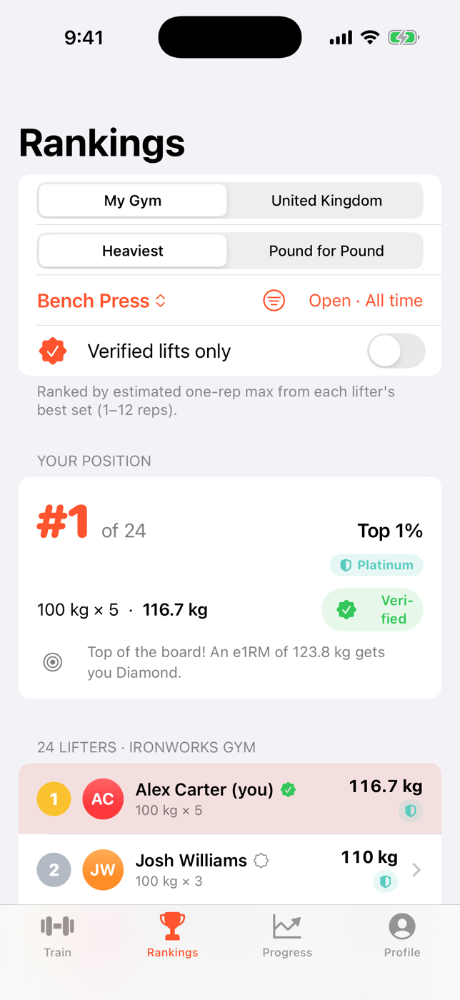 | 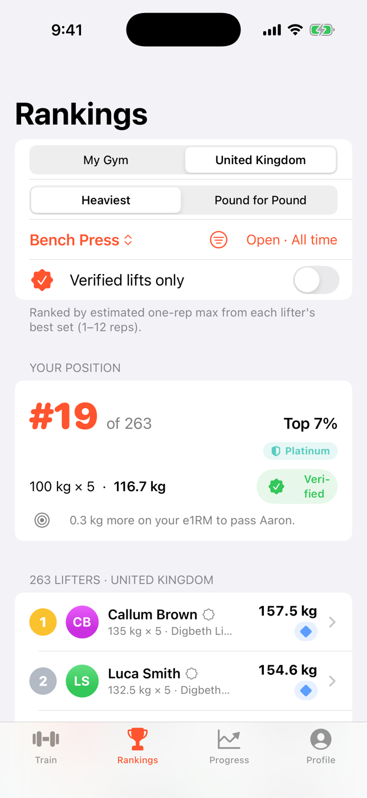 | 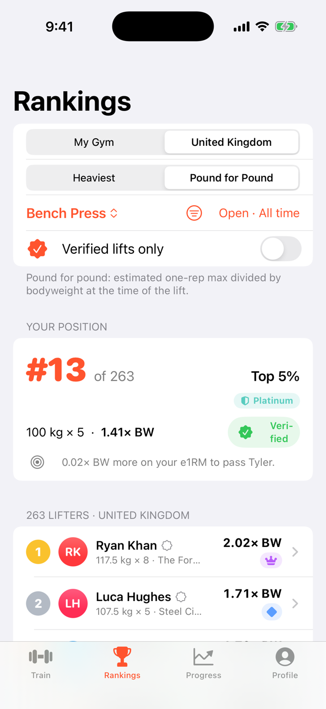 | 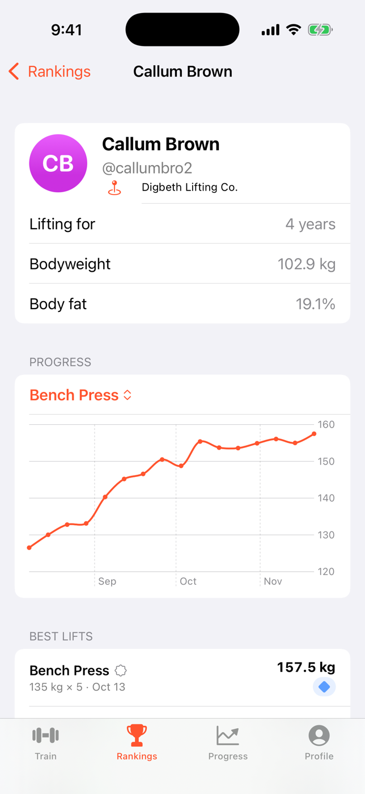 |

| Welcome | Progress | Profile | Pro |
|---|---|---|---|
| 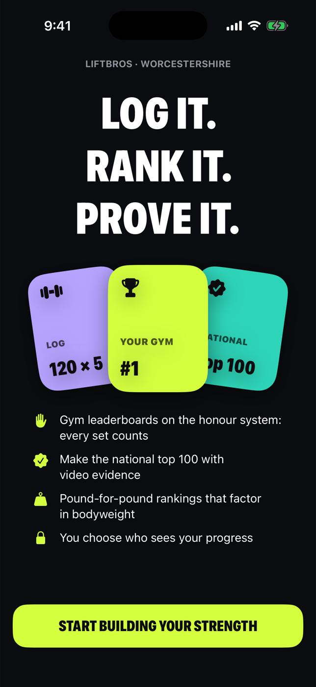 | 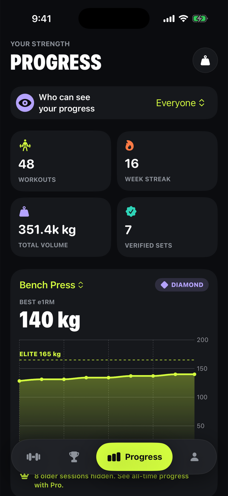 | 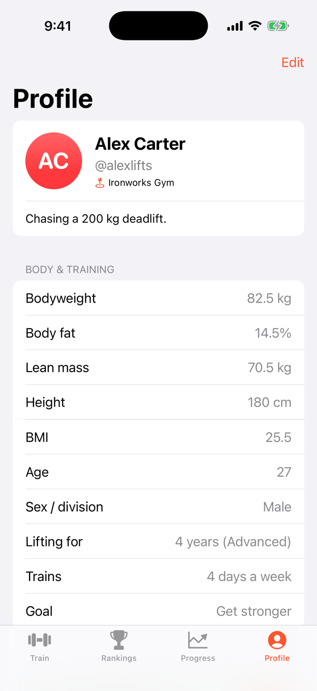 | 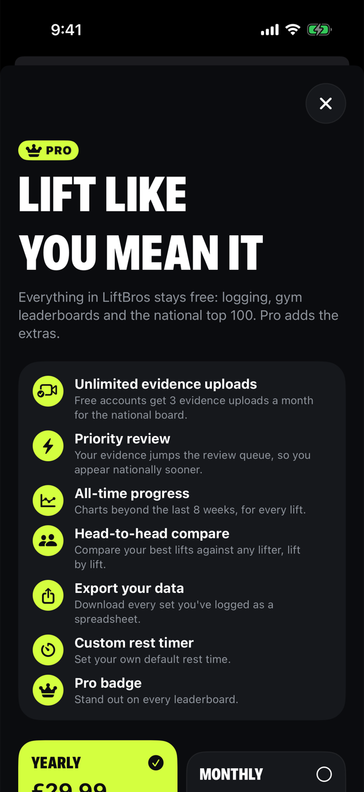 |

| Gym screen (B2B) |
|---|
| 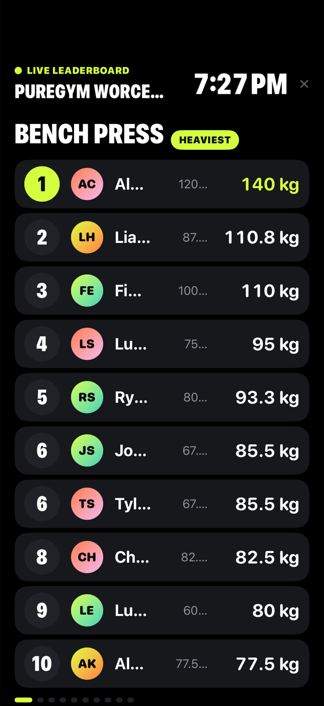 |

🎬 [Screen recording (30 s tour)](docs/screenshots/liftbros-tour.mp4)

Screenshots are generated automatically by the **Screenshots** workflow (`scripts/capture-screens.sh`), using the app's Debug-only demo mode (`-LBDemo`, `-LBScreen <name>`, `-LBTour`).

## Features

- **Workout logging**: 26 commercial-gym exercises, including bench press, squat, deadlift, lat pulldown, leg press, cable rows, machines, dumbbells and weighted pull-ups/dips. Log weight × reps, warm-ups and RPE. It includes a rest timer and PR celebrations, and pre-fills from your last set.
- **Gym leaderboards (honour system)**: every lift logged at your gym counts straight away, with a podium, your rank and the gap to the next lifter. Filter by division (Open, Men, Women) and all time or this month's season.
- **National leaderboard (evidence required)**: shows the UK top 100 verified lifts. If your best lift would make the top 100, the app shows your provisional position and asks you to upload video evidence to be listed.
- **Pound-for-pound board**: a separate ranking by estimated 1RM ÷ bodyweight at the time of the lift.
- **Evidence**: attach a video of a set. It goes *Pending → Verified*. Anyone can report a suspicious lift.
- **LiftBros Pro** (£3.99/mo or £29.99/yr, StoreKit 2): unlimited evidence uploads (free accounts get 3 a month), priority review, all-time charts, head-to-head compare, CSV export, a custom rest timer and a Pro badge. See [docs/MONETISATION.md](docs/MONETISATION.md).
- **LiftBros for Gyms**: a subscription base for gyms (Screen £99, Screen+ £199, Network) to show their leaderboard live on gym TVs. Gym screen mode pairs a device with a code and rotates boards, the monthly challenge and a join QR code.
- **Strength tiers**: Bronze → Silver → Gold → Platinum → Diamond → Elite per lift, from bodyweight-ratio standards adjusted by sex.
- **Progress tracking**: e1RM charts with next-tier target lines, personal bests, weekly volume, streaks and a bodyweight trend.
- **Privacy controls**: choose who sees your progress and your body stats (Everyone / My gym / Only me), and whether you appear on leaderboards.
- **Body profile**: bodyweight, body fat, lean mass, height, BMI, age, years lifting, training days and goal.
- **Tools**: a plate calculator (UK plates) and a 1RM calculator with rep targets.
- Works offline: everything is saved on the device as you log.

## Install on your iPhone (no Mac needed)

The **Build IPA** workflow produces `dist/LiftBros-unsigned.ipa` (Release, arm64, iOS 17+) on every app change.

1. Download `dist/LiftBros-unsigned.ipa` from this branch.
2. Install [Sideloadly](https://sideloadly.io) (Windows or Mac) or AltStore, plug in your iPhone, drag in the .ipa and sign in with your Apple ID. The tool signs the app with your account as it installs.
3. On the iPhone, turn on **Settings → Privacy & Security → Developer Mode**, then trust your Apple ID under **Settings → General → VPN & Device Management**.

With a free Apple ID the app must be re-signed every 7 days (Sideloadly/AltStore can refresh it). A paid Apple Developer account removes that limit and enables TestFlight.

## Running it

Requires **Xcode 16+** and iOS 17+.

1. Open `LiftBros.xcodeproj`.
2. Pick an iPhone simulator and press **Run**.
3. To run on your own phone, choose your team under *Signing & Capabilities* and change the bundle ID from `com.liftbros.app`.

The app runs against `MockBackendService`, a generated community of ~300 lifters across 13 (fictional) UK gyms, so the leaderboards are populated straight away. Proof uploads are "reviewed" automatically after about 6 seconds so you can see the verification flow end to end. See [docs/BACKEND.md](docs/BACKEND.md) for connecting a real backend.

## Tests

The platform-independent core (models, scoring, leaderboard ranking, progress analysis, mock data and persistence) is a Swift package:

```sh
swift test
```

CI (`.github/workflows/ci.yml`) runs those tests and builds the iOS app on every push.

## Project layout

```
LiftBros/
  App/          App entry point and AppStore (state, persistence, sync)
  Core/         Platform-independent code, also built as the LiftBrosCore package
    Models/     Exercise library, profile, workouts, leaderboard types
    Logic/      StrengthCalculator, LeaderboardEngine, ProgressAnalyzer, PlateCalculator
    Services/   BackendService protocol, MockBackendService, LocalStore
    Data/       Deterministic UK mock community
  Features/     SwiftUI screens: Onboarding, Workout, Leaderboard, Progress, Profile, Tools
  Components/   Theme, badges and inputs
Tests/LiftBrosCoreTests/
docs/
  RESEARCH.md   Competitor, monetisation and feature research
  BACKEND.md    Backend schema and verification pipeline plan
```

## Roadmap

See [docs/RESEARCH.md](docs/RESEARCH.md). In short: a real backend with Sign in with Apple, gym join by QR code, a friends feed, gym-vs-gym challenges, Apple Health/Watch, a LiftBros Pro subscription (never paywalling logging or leaderboards) and gym B2B partnerships.
